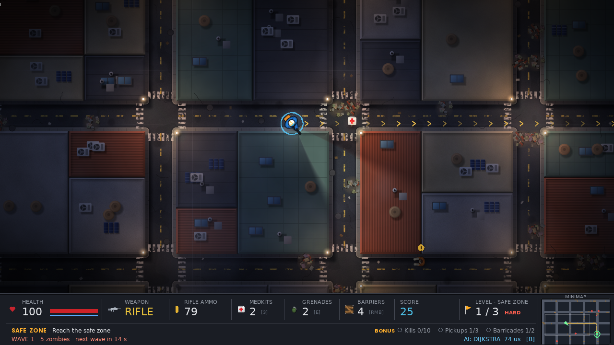
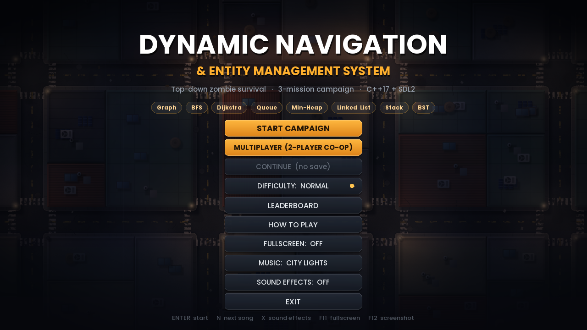
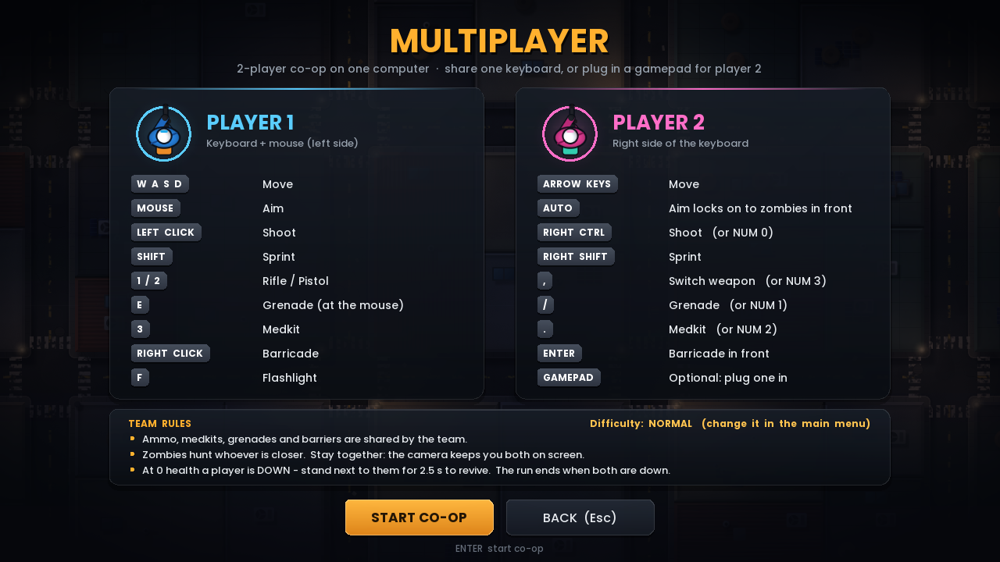
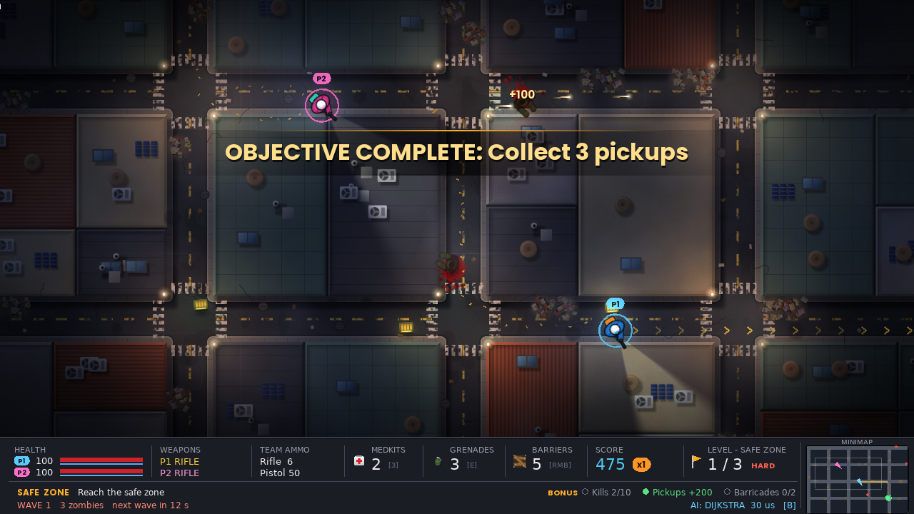

# Dynamic Navigation and Entity Management System (SDL2)

A zombie survival campaign written in **C++17** with **SDL2** and **SDL2_ttf**. Under the game sits a set of hand-written data structures and a city modelled as a graph, so the project doubles as a working demonstration of BFS, Dijkstra, queues, heaps, stacks, linked lists and binary search trees in a real-time setting.

The core idea is *dynamic navigation*: every barricade the player places or removes edits the city graph at runtime, and every zombie re-plans its route with the selected algorithm (BFS or Dijkstra) when the graph changes.



---

## Contents

- [Features](#features)
- [Screenshots](#screenshots)
- [Building and running](#building-and-running)
- [Controls](#controls)
- [Gameplay](#gameplay)
- [Data structures and algorithms](#data-structures-and-algorithms)
- [Architecture](#architecture)
- [Pathfinding demo (BFS vs Dijkstra)](#pathfinding-demo-bfs-vs-dijkstra)
- [Customising audio and fonts](#customising-audio-and-fonts)
- [Generated files](#generated-files)
- [Evaluation ideas](#evaluation-ideas)
- [Known limitations](#known-limitations)
- [Credits](#credits)

---

## Features

**Gameplay**
- Three-mission campaign (Safe Zone, Fuel Run, Last Stand) with a boss wave in the final mission.
- Five zombie types (Walker, Runner, Tank, Spitter, Boss) with different speed, health, damage and score values.
- Barricades with durability: zombies can chew through them, so a fully sealed player can still be reached.
- Noise system (the rifle draws more attention than the pistol), sprint with stamina, grenades that also hurt the player, medkits, flashlight, air drops, rubble, combo score multiplier (up to ×5).
- Three difficulty levels and three bonus objectives per mission.
- Undo for barricade actions, save/load, and a persistent leaderboard.
- **2-player local co-op** on one computer, with shared inventory, a downed/revive mechanic and a camera leash. Player 2 can use the keyboard or a gamepad.

**Presentation**
- Hardware-accelerated SDL2 renderer; a 1280×720 canvas letterboxed to any screen, with text rendered at native resolution so it stays sharp on 1080p and 4K.
- Night lighting through a light map: street lamps, flashlight beam, muzzle flashes, explosions, glowing acid and pickups.
- **All textures are generated in code at start-up** (`Art.cpp`): roads, pavements, rooftops, shadows, character and zombie sprites, pickups and barricades.
- Visual effects: tracers, shell casings, blood, corpses, fire and smoke, sparks, screen shake and floating score text.
- **Four original songs and all sound effects are synthesised in code** (`Music.cpp`, `Audio.cpp`), with positional (panned, distance-attenuated) sound. No audio files are required.

---

## Screenshots

| Main menu | Multiplayer setup |
|---|---|
|  |  |

| Single player | Co-op |
|---|---|
|  |  |

---

## Building and running

### Requirements

- A C++17 compiler (GCC/MinGW-w64 tested via MSYS2)
- SDL2 and SDL2_ttf development libraries
- The `assets/` folder must sit next to the executable (it holds the fonts)

### Windows (one-click)

1. Install [MSYS2](https://www.msys2.org) once, in the default folder `C:\msys64`.
2. Double-click **`build_and_run.bat`**. On the first run it:
   - installs GCC, SDL2 and SDL2_ttf through `pacman` if they are missing (needs internet),
   - builds `game.exe`,
   - copies the required DLLs next to `game.exe`,
   - starts the game.
3. Afterwards, launch with `game.exe` or `run.bat`.

If MSYS2 is installed somewhere else, edit the `set MSYS=` line at the top of `build_and_run.bat`.

### Windows (manual, MSYS2 UCRT64 terminal)

```bash
pacman -S --needed mingw-w64-ucrt-x86_64-gcc mingw-w64-ucrt-x86_64-SDL2 mingw-w64-ucrt-x86_64-SDL2_ttf
g++ -std=c++17 -O2 *.cpp -o game.exe -lSDL2_ttf -lSDL2 -static-libgcc -static-libstdc++
./game.exe
```

### Linux (Debian/Ubuntu)

```bash
sudo apt install libsdl2-dev libsdl2-ttf-dev
g++ -std=c++17 -O2 *.cpp -o game $(sdl2-config --cflags --libs) -lSDL2_ttf
./game
```

### CMake

```bash
cmake -B build
cmake --build build
./build/game
```

The CMake build copies `assets/` next to the executable automatically. It relies on `find_package(SDL2_ttf)`, which needs an SDL2_ttf installation that ships a CMake config file; on older distributions that do not, use the `g++` command above instead.

### Command-line options

| Option | Effect |
|---|---|
| *(none)* | Start in fullscreen |
| `--windowed` | Start in a window |
| `--demo` | Run the console BFS vs Dijkstra demo (no window) |

---

## Controls

### Player 1 (keyboard + mouse)

| Key | Action |
|---|---|
| `W A S D` / arrow keys | Move (in co-op, the arrow keys belong to player 2) |
| `Shift` | Sprint (uses stamina) |
| Left mouse | Shoot |
| Right mouse | Place / remove a barricade on a road tile |
| `1` / `2` | Rifle / Pistol |
| `E` | Throw grenade at the mouse cursor (can hurt you) |
| `3` | Use medkit |
| `5` or `F` | Toggle flashlight |
| `U` | Undo last barricade action |
| `B` | Switch zombie AI between BFS and Dijkstra |
| `Tab` | Show every zombie's path |
| `F5` / `F9` | Save / load (single-player only) |
| `F11` | Toggle fullscreen |
| `F12` | Screenshot (`screenshot_001.bmp`, …) |
| `N` | Next song (cycles the four songs, then music off) |
| `X` | Sound effects on/off (off at start) |
| `Esc` or `P` | Pause (`M` in pause returns to the main menu) |
| `Enter` | Start / next mission / play again |

### Player 2 (co-op, keyboard)

| Key | Action |
|---|---|
| Arrow keys | Move |
| `Right Ctrl` or `Num 0` | Shoot (aim locks on to the nearest zombie in front) |
| `Right Shift` | Sprint |
| `,` or `Num 3` | Switch weapon |
| `/` or `Num 1` | Throw grenade |
| `.` or `Num 2` | Use medkit |
| `Enter` | Place / remove barricade in front |

### Player 2 (co-op, gamepad)

| Input | Action |
|---|---|
| Left stick / right stick | Move / aim |
| `RT` or `A` | Shoot |
| `LB` (or `LT`) | Sprint |
| `B` | Grenade |
| `X` | Medkit |
| `Y` | Switch weapon |
| `RB` | Barricade |
| `Start` | Pause |

---

## Gameplay

### Campaign

| # | Mission | Objective |
|---|---|---|
| 1 | **Safe Zone** | Reach the safe zone. |
| 2 | **Fuel Run** | Collect 3 fuel cans (arrows point to the nearest), then reach the Evacuation Point. |
| 3 | **Last Stand** | Survive 75 seconds while a boss arrives, then reach the Helipad. |

Each mission also has three bonus objectives: kill 10 zombies, collect 3 pickups, and place 2 barricades.

### Zombie types

Base values on Normal difficulty (Easy and Hard scale speed, damage and wave size).

| Type | HP | Speed | Damage | Points | Notes |
|---|---|---|---|---|---|
| Walker | 3 | 70 | 15 | 100 | Standard |
| Runner | 2 | 115 | 10 | 150 | Fast, fragile |
| Tank | 8 | 48 | 30 | 300 | Slow, heavy hitter |
| Spitter | 3 | 60 | 8 | 200 | Ranged acid attack |
| Boss | 30 | 52 | 45 | 1500 | Appears in Last Stand |

### Starting inventory

Rifle 60 · Pistol 30 · Medkit 2 · Grenade 2 · Barrier 5 · Torch 1

### Co-op rules

- Ammo, medkits, grenades and barriers are shared; so are the score and mission progress.
- Zombies hunt whichever living player is closer.
- A player at 0 health is **down**. The partner revives them by standing nearby for 2.5 s (they return with 35 health).
- The run ends only when both players are down.
- A leash keeps both players on one screen.
- Save/load is disabled in co-op. Co-op runs are recorded on the leaderboard as "Co-op Team".

---

## Data structures and algorithms

The queue, heap, stack, linked list and BST are hand-written with raw arrays or pointers rather than STL containers; the graph stores its adjacency list in `std::vector`.

| Structure / algorithm | File | Used for |
|---|---|---|
| Graph (adjacency list) | `Graph.h/.cpp` | The city: 60×40 tiles, nodes = tiles, edges = walkable neighbours. Road costs 1, rubble costs 3. Edges are rebuilt locally whenever a tile changes. |
| BFS | `Graph.cpp` | Fewest-steps path; frontier stored in the hand-written `Queue`. |
| Dijkstra | `Graph.cpp` | Cheapest path on weighted edges; frontier stored in the hand-written `PriorityQueue`. Default zombie AI. |
| Circular-array queue (FIFO) | `Queue.h/.cpp` | BFS frontier and the zombie wave queue. Grows dynamically; implements the Rule of Three. |
| Binary min-heap | `PriorityQueue.h/.cpp` | Dijkstra frontier and the threat queue (most dangerous zombie first). |
| Stack (LIFO) | `ActionStack.h/.cpp` | Undo history of barricade placements and removals. |
| Singly linked list | `Inventory.h/.cpp` | Player inventory (named items with counts). |
| Binary search tree | `Leaderboard.h/.cpp` | Leaderboard keyed by score; reverse in-order traversal gives highest first. Persisted with C file I/O. |
| Text serialisation | `GameSave.h/.cpp` | Save/load. The file is fully parsed into a `SaveData` before anything is applied, so a corrupt file never half-loads. |

The game records the average time per path query for both algorithms (exponential moving average, in microseconds) and shows it under the minimap, which makes live BFS vs Dijkstra comparisons possible while playing.

---

## Architecture

The project is split into a **logic layer** that contains no graphics code at all and a **presentation layer** that only reads the game state.

```
keyboard / mouse / gamepad
        │
        ▼
      App ──► Input ──► Game::update(dt, input)          (rules, AI, data structures)
                              │  read-only
                              ▼
                             Fx  (diffs this frame against the last one to detect events)
                         ┌────┴─────────────┐
                         ▼                  ▼
              Renderer / Screens        sound cues
                         │                  │
                         ▼                  ▼
                        Gfx ──► SDL2     Audio ──► SDL2 audio device
```

The `Game` class has no event callbacks. Instead, `Fx` keeps a snapshot of the previous frame and compares it with the current one: a bullet that vanished early is an impact, a zombie missing from the list has died, an explosion whose timer equals `dt` has just gone off. The rules never know the graphics exist.

This separation was tested in practice: the logic files were carried over unchanged when the project moved from SFML to SDL2. Only `Game.cpp` was later extended, for co-op, and single-player behaviour was checked to be bit-for-bit identical for the same scripted input.

### File map

**Logic (no graphics library)**

| File | Responsibility |
|---|---|
| `GameTypes.h` | Shared types, world constants, enums, save-file records |
| `Entities.h` | Zombie, pickup, bullet, grenade, explosion and input structs |
| `Game.h/.cpp` | All game rules: movement, combat, waves, zombie AI, noise, barricades, co-op |
| `Mission.h/.cpp` | Campaign definitions and progress |
| `Graph.h/.cpp` | City graph, BFS, Dijkstra |
| `Queue.h/.cpp`, `PriorityQueue.h/.cpp`, `ActionStack.h/.cpp`, `Inventory.h/.cpp`, `Leaderboard.h/.cpp` | Data structures |
| `GameSave.h/.cpp` | Save/load |
| `PathfindingDemo.cpp` | Console BFS vs Dijkstra demo |

**Presentation (SDL2)**

| File | Responsibility |
|---|---|
| `SdlInc.h` | Includes SDL2 / SDL2_ttf regardless of install layout |
| `Gfx.h/.cpp` | Window, fullscreen, letterboxing, shapes, cached text, widgets, screenshots |
| `Art.h/.cpp` | Procedural textures (noise + anti-aliased signed-distance shapes) |
| `Fx.h/.cpp` | Visual effects and sound cues via frame diffing |
| `Audio.h/.cpp` | Sound synthesis, mixer, positional playback, background song composer |
| `Music.h/.cpp` | The four songs: step sequencer, synthesisers, effects |
| `Renderer.h/.cpp` | Camera, world drawing, light map, minimap, menu backdrop |
| `Screens.h/.cpp` | HUD bar, menus, leaderboard, help, overlays, toasts |
| `App.h/.cpp` | Event loop, input mapping, screen switching |
| `main.cpp` | Entry point and command-line options |

**Other**

| Path | Contents |
|---|---|
| `assets/` | Fonts (`ui.ttf`, `title.ttf`, `font.ttf`), font licences, optional `sfx/` overrides |
| `screenshots/` | Images used in this README |
| `legacy_c_modules/` | Earlier C11 versions of the data structures. **Not part of the current build.** |
| `CMakeLists.txt`, `build_and_run.bat`, `run.bat` | Build and launch scripts |

---

## Pathfinding demo (BFS vs Dijkstra)

`PathfindingDemo.cpp` compares the two algorithms on a small hand-made map where the shortest route (by steps) crosses rubble and the cheapest route does not.

Run it from the game:

```bash
game.exe --demo
```

Or build it on its own, without SDL2:

```bash
g++ -std=c++17 -DPATHFINDING_DEMO_MAIN PathfindingDemo.cpp Graph.cpp Queue.cpp PriorityQueue.cpp -o demo
./demo
```

It runs three scenarios:

1. **Original map.** BFS takes the top corridor (15 steps, cost 21, crosses 3 rubble tiles). Dijkstra takes the bottom corridor (17 steps, cost 17). BFS minimises steps; Dijkstra minimises cost.
2. **Barricade added.** The top route is blocked, both algorithms re-route and agree (17 steps, cost 17). This is dynamic navigation in miniature.
3. **Goal sealed.** Both report that no route exists.

Timings (µs per call) are also printed; they depend on the machine.

---


## Known limitations

- Save/load is single-player only.
- Co-op is local only (one computer); there is no network play.
- The game starts in fullscreen by default; use `--windowed` or `F11` if that is inconvenient.

---

## Credits

- **Fonts:** Poppins Medium and Poppins Bold by Indian Type Foundry (SIL Open Font License 1.1); DejaVu Sans (Bitstream Vera / DejaVu license). See `assets/FONT_LICENSE.txt`.
- **Libraries:** [SDL2](https://www.libsdl.org) and [SDL2_ttf](https://github.com/libsdl-org/SDL_ttf).
- All textures, music and sound effects are generated procedurally by the project's own code.
